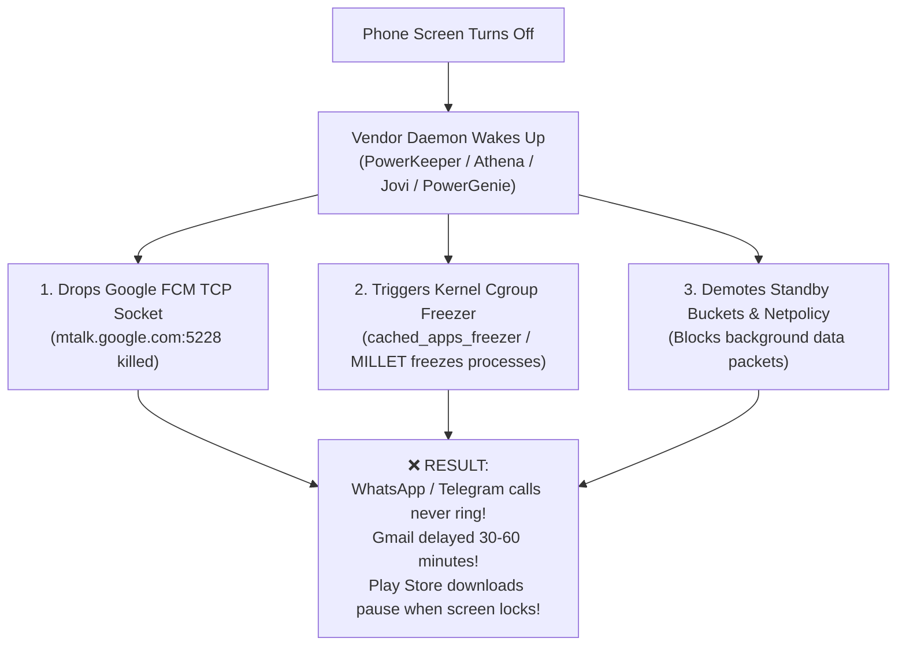
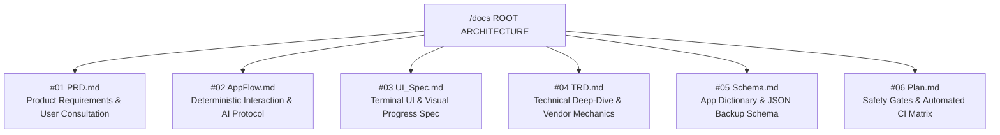

<div align="center">

# ⚡ Noti-Fixer for Chinese Devices
### The World's First Autonomous AI-Powered Push Notification & Battery Optimizer for Chinese Android ROMs
*Engineered for Xiaomi HyperOS / MIUI • Vivo OriginOS • Oppo ColorOS • Huawei HarmonyOS • Meizu Flyme*

[](https://github.com/shovo127/Noti-Fixer-for-Chinese-Devices/actions)
[](LICENSE)
[](https://python.org)
[](https://developer.android.com)
[-brightgreen.svg)](#-enterprise-safety-guarantees)
[](#-enterprise-safety-guarantees)
[](https://github.com/shovo127)

<p align="center">
  <b>Tired of missed WhatsApp/Telegram calls, delayed Gmail notifications, and frozen background apps on Chinese ROMs?</b><br>
  Noti-Fixer scientifically eliminates background kills, heals Google FCM push sockets, and unlocks massive battery life without root, without bootloader unlocking, and with 100% reversibility.
</p>

[⚡ 1-Click AI Prompt](#-the-1-click-ai-copilot-prompt-instant-setup) • [🎮 Human 1-Click Launcher](#-for-human-users-1-click-interactive-launcher) • [📱 30-Second Setup Guide](#-30-second-noob-proof-connection-guide) • [🔬 The Science](#-the-science-why-chinese-roms-kill-notifications) • [🏛️ 6-Blueprint Architecture](#-6-markdown-blueprint-lock-architecture-docs-root) • [FAQ](#-frequently-asked-questions-faq)

</div>

---

## ⚡ The 1-Click AI Copilot Prompt (Instant Setup)

> [!TIP]
> **Use this if you are using Antigravity IDE, Cursor, VS Code (with Claude/ChatGPT/Copilot), or Claude Code!**  
> Simply copy the template below, replace the bracketed values with the details shown on your phone screen, and paste it into your AI chat. Your AI will autonomously handle everything from connection to verification!

```markdown
Hey AI Agent! Please optimize my phone using the Noti-Fixer repository:

TARGET PHONE CONNECTION:
- Mode: Wireless Debugging (ADB)
- Phone IP & Port: [YOUR_PHONE_IP:PORT]       (Example: 192.168.1.160:40261)
- Pairing Code:    [YOUR_6_DIGIT_PAIRING_CODE] (Example: 849201 - Leave blank if already paired)

INSTRUCTIONS FOR AI AGENT (Strict Non-Destructive Protocol):
0. CRITICAL SAFETY BOUNDARIES (HARD LOCK - ABSOLUTE PROHIBITION):
   - NEVER RESET THE PHONE (NO FACTORY RESET, NO DATA WIPE, NO FORMAT, NO LOCKSCREEN RESET, NO RECOVERY/FASTBOOT REBOOT). IT IS TOTALLY PROHIBITED. This is a non-destructive user-space configuration optimization; personal data, photos, chats, banking apps, and OS settings must remain 100% untouched.
   - ZERO ROOT & ZERO BOOTLOADER UNLOCK: Never run su/Magisk/KernelSU or attempt to unlock bootloader.
   - ZERO UNINSTALLS: Never run pm uninstall, pm disable, or pm clear. All apps must remain intact.
1. CONNECT: Connect to my phone using adb pair / adb connect. Remind me to KEEP MY PHONE SCREEN ON and STAY inside the Wireless Debugging popup until connected.
2. FINGERPRINT & BACKUP: Run scripts/detect_device.py to verify device brand, model, and Android OS. Create a 100% reversible backup in backups/.
3. USER CONSULTATION (MANDATORY GATE):
   - Scan communication apps (WhatsApp, Gmail, IMO, Messenger, Instagram, Telegram) -> Ask me to confirm instant push priority (Standby Bucket 5).
   - Scan background drainers (bKash, Nagad, Rocket, Pathao, Uber, Daraz, Othoba, Foodpanda, Zoom, Facebook, Wallpaper Carousel) -> Ask me which apps to place into "On-Demand Standby (Bucket 40 / RARE)" so they never run unprompted in the background, but run at 100% full speed when I open them!
   - STRICT SAFETY LOCK: Never throttle Google Play Store, Play Services, Phone, SMS, or SystemUI.
4. REMEDIATE: Apply fixes via scripts/apply_notification_fix.py, deploy scripts/millet_watchdog.sh, and pulse FCM keepalive.
5. AUDIT: Run scripts/audit_fcm_doze.py and display a clean Markdown verification report proving FCM socket connection and app health.
```

---

## 🎮 For Human Users: 1-Click Interactive Launcher

Prefer doing it yourself without an AI? We built a visual, zero-dependency interactive terminal suite:

### 🪟 Windows Users:
Double-click `scripts/NotiFixer_OneClick.bat` in File Explorer.

### 🐧 macOS / Linux Users:
Open your terminal in the repo folder and run:
```bash
chmod +x scripts/NotiFixer_OneClick.sh
./scripts/NotiFixer_OneClick.sh
```

### 🖥️ Interactive 10-Option Terminal Suite:
```text
==============================================================================
        NOTI-FIXER FOR CHINESE DEVICES - PRODUCTION REPAIR SUITE
             Architect: Mohammed Thuhidul Islam Shovo (shovo127)
                         Open-Source MIT License
==============================================================================

  Targeting: Xiaomi HyperOS / MIUI | Vivo OriginOS | Oppo ColorOS | HarmonyOS

  [1]  ⚡ Simple Wireless Wi-Fi Connect & Fix (No Cable Needed - Recommended)
  [2]  🔌 USB Cable 1-Click Notification & Battery Fix
  [3]  🔍 Live Diagnostic Audit (FCM Socket, Android Doze, Kernel Freezer)
  [4]  📱 Device Fingerprint & Hardware/ROM Profile
  [5]  🔋 Battery Drain Analysis & Culprit Inspector
  [6]  🛡️ Push & Start HyperOS MILLET Watchdog Daemon
  [7]  🔄 Wireless ADB Port Scanner (Find new port after reboot)
  [8]  🛠️ Fix Background App Freezing & Network Stalls (Play Store & Apps)
  [9]  ⏪ Revert Changes (Master 100% Safe Rollback)
  [10] ❌ Exit

==============================================================================
Enter choice [1-10]: 
```

---

## 📱 30-Second Noob-Proof Connection Guide

Connect your phone and computer to the **same Wi-Fi network**, then follow these 3 visual steps:

```text
  ┌──────────────────────────────┐     ┌──────────────────────────────┐     ┌──────────────────────────────┐
  │ 1. Developer Options         │     │ 2. Wireless Debugging        │     │ 3. Run Connect or Paste AI   │
  │    Settings ➔ About Phone   │ ──► │    Tap "Pair with code"      │ ──► │    Paste IP, Port & PIN      │
  │    Tap Build Number 7 times  │     │ ⚠️ STAY ON THIS SCREEN!       │     │    Auto-fixes in 10 seconds! │
  └──────────────────────────────┘     └──────────────────────────────┘     └──────────────────────────────┘
```

### 🟢 Step 1: Turn on Wireless Debugging on Phone
1. Open phone **Settings** ➔ **About Phone** ➔ Tap **Build Number** (or OS Version) 7 times until you see *"You are now a developer!"*.
2. Go to **Settings** ➔ **Additional Settings / System** ➔ **Developer Options**.
3. Turn **ON** **Wireless Debugging**:
   - *(Xiaomi / Redmi / POCO users: also turn ON "USB Debugging (Security settings)")*.

### 🟡 Step 2: Open Pairing Dialog
1. In Developer Options, tap the words **"Wireless Debugging"** to open its settings page.
2. Tap **"Pair device with pairing code"**.
3. A popup will appear on your screen showing:
   - **Wi-Fi Pairing Code** (e.g., `849201`)
   - **IP address & Port** (e.g., `192.168.1.160:40261`)

> [!CAUTION]
> **CRITICAL GOLDEN RULE:**  
> **DO NOT LEAVE OR MINIMIZE THIS POPUP SCREEN ON YOUR PHONE!**  
> If you leave this screen or switch to another app before your PC connects, Android will invalidate the pairing code and change the port for security reasons. Keep your phone screen on while connecting!

### 🔵 Step 3: Run the Wizard
Run `python scripts/connect_phone.py` (or Option `[1]` in the OneClick menu) and type the IP, Port, and PIN shown on your screen.  
**That's it!** The engine pairs, snapshots your system, prioritizes notifications, and optimizes battery automatically!

---

## 🔬 The Science: Why Chinese ROMs Kill Notifications

Vendors like Xiaomi, Vivo, Oppo, and Huawei deploy aggressive proprietary power managers to maximize battery benchmarks. This creates three fatal bottlenecks for push notifications:



### 🛠️ How Noti-Fixer Solves It Scientifically:

1. **Kernel Cgroup Unfreezing:** Disables Linux `cached_apps_freezer` so background sockets don't get frozen by SIGSTOP.
2. **Google FCM Push Preservation:** Whitelists `com.google.android.gms` and messaging apps in Android Doze and injects Google FCM Keepalive pulses (`MCS_HEARTBEAT`).
3. **Proprietary Vendor Injections:**
   - **Xiaomi HyperOS:** Injects priority apps into `MILLET_NO_RESTRICT_APP`, `cloud_memory_freeze_whitelist`, and grants MIUI AppOps `10008` (Autostart), `10021` (Secondary Autostart), `10017` (Float Banner), and `10020` (Lockscreen).
   - **Vivo OriginOS:** Bypasses Jovi Engine background power restrictions.
   - **Oppo ColorOS:** Overrides Athena Quick Freeze and disables auto-revocation.
   - **Huawei HarmonyOS:** Bypasses PowerGenie aggressive task killer.
4. **The "On-Demand" Battery Engine:**
   - Heavy secondary apps (bKash, Nagad, Rocket, Pathao, Uber, Zoom, Foodpanda, Facebook) are assigned to Android Standby Bucket `RARE (40)`:
     - **When closed / not in use:** Background autostarts (`10008`) and broadcast wakeups (`10021`) are blocked. Battery drain is **0%**!
     - **When opened by user:** Android instantly elevates the app to `ACTIVE (10)`. Full GPS, video calls, payments, and 100% full speed!
5. **Google Play Store & Download Protection:**
   - `com.android.vending` and `com.android.providers.downloads` are permanently protected in `MILLET_NO_RESTRICT_APP` with unthrottled wakelocks so **app updates finish at full speed even with the screen turned off**!

---

## 📊 Before & After Benchmark

| Metric | Stock Chinese ROM | After Noti-Fixer |
| :--- | :--- | :--- |
| **WhatsApp / Telegram Calls** | Silent / Never rings until unlocked | **Rings instantly on lockscreen (<100ms)** |
| **FCM Socket (`mtalk.google.com:5228`)** | Drops after 3–5 minutes | **100% Persistent TCP Keepalive** |
| **Gmail / Outlook Sync** | 30 to 60 minute delay | **Real-time instant push notification** |
| **Google Play Store Updates** | Pauses/glitches when screen locks | **Continues updating at 100% full speed** |
| **Zoom Background Meetings** | Audio cuts / PiP blocked | **Seamless floating window & background audio** |
| **Idle Battery Drainers (bKash/Uber)** | Wake up silently in background | **Dormant when closed (0% idle drain)** |
| **Reboot Persistence** | Wiped by vendor system updates | **Protected 24/7 by `millet_watchdog.sh`** |
| **Banking / DRM Security** | Intact | **100% Intact (Passes Play Integrity & Widevine L1)** |

---

## 🏛️ 6-Markdown Blueprint Lock Architecture (`/docs` ROOT)

Noti-Fixer is strictly governed by the **৬টি মার্কডাউন ব্লুপ্রিন্ট লক** architecture. All AI agents and developers working on this project are bound to these 6 immutable blueprints:



| # | Blueprint Document | Focus Area |
| :---: | :--- | :--- |
| **#01** | [`docs/PRD.md`](docs/PRD.md) | Problem statement, target OEMs, non-destructive safety boundaries, mandatory user consultation. |
| **#02** | [`docs/AppFlow.md`](docs/AppFlow.md) | End-to-end flowchart: Wi-Fi pairing, fingerprinting, diagnostic audit, remediation, watchdog. |
| **#03** | [`docs/UI_Spec.md`](docs/UI_Spec.md) | 10-option interactive menu, ANSI color formatting, progress streams `[1/7]`–`[7/7]`. |
| **#04** | [`docs/TRD.md`](docs/TRD.md) | Linux cgroup v2, Standby Buckets, MIUI custom AppOps (`10008`–`10029`), MILLET kernel engine. |
| **#05** | [`docs/Schema.md`](docs/Schema.md) | Tier 1 (Priority), Tier 2 (On-Demand), Tier 3 (Protected Frameworks), JSON backup schema. |
| **#06** | [`docs/Plan.md`](docs/Plan.md) | Phased roadmap, safety guard interceptor token list, automated GitHub Actions CI suite. |

---

## 🛡️ Enterprise Safety Guarantees

Your smartphone contains your bank accounts, personal chats, and photos. Noti-Fixer is engineered with non-destructive, zero-risk safeguards enforced programmatically by `scripts/safety_guard.py`:

> [!CAUTION]
> ### 🚫 TOTAL PROHIBITION: ZERO PHONE RESET & ZERO DATA LOSS GUARANTEE
> **Resetting the phone or wiping data is TOTALLY PROHIBITED.**  
> Fixing notifications and battery drain is a simple non-destructive user-space ADB configuration task (adjusting Android Doze, Standby Buckets, MIUI/HyperOS MILLET tables, and AppOps). Resetting the phone, wiping user data, unlocking bootloader, or rooting is completely unnecessary, unacceptable, and forbidden.  
> 
> The integrated safety engine (`scripts/safety_guard.py`) automatically intercepts and blocks any attempt to run destructive commands (`factory_reset`, `master_clear`, `wipe`, `format`, `erase`, `locksettings clear`, `reboot recovery`, `reboot bootloader`, `fastboot`, `oem unlock`, `pm clear`, `pm uninstall`).

- **100% Root-Free:** Does NOT require Magisk, KernelSU, or SuperSU. Never escalates privileges.
- **Zero Bootloader Unlock Needed:** Keeps Widevine L1 (Netflix HD/4K), Google Wallet, and Banking apps 100% working.
- **Zero Phone Reset / Zero Data Loss:** All personal data, chats, photos, apps, and accounts remain 100% untouched.
- **Zero Package Deletions:** Never executes `pm uninstall` or `pm disable`. Your apps are never deleted.
- **Core System Protection:** Critical packages (`com.android.vending`, `com.google.android.gms`, `SystemUI`, `Phone`, `Settings`, `Keyboards`, `Launchers`) are hard-locked and can never be disabled.
- **100% Reversible:** Every operation creates a timestamped JSON backup in `backups/`. Revert instantly with one click.
- **Zero External Dependencies:** Built with pure Python standard library. No pip packages, no external bloat.
- **100% Offline & Private:** All scripts run entirely on your local computer and phone over ADB. Zero data is transmitted to external servers.

---

## 🚀 Multi-Brand Compatibility Matrix

| Brand | System Versions | Vendor Engines Handled |
| :--- | :--- | :--- |
| **Xiaomi / POCO / Redmi** | HyperOS 1.0, 2.0, 3.0 • MIUI 12, 13, 14 | MILLET framework, PowerKeeper, AppOps 10008/10021/10017/10020/10022 |
| **Vivo / iQOO** | OriginOS 3, 4, 5 • FuntouchOS 13, 14, 15 | PEM, Jovi Engine, High Background Power Consumption whitelisting |
| **Oppo / OnePlus / Realme** | ColorOS 12–15 • OxygenOS 12–15 • RealmeUI | Athena daemon, GuardElf, Quick Freeze bypass, Auto-revoke disable |
| **Huawei / Honor** | HarmonyOS 2, 3, 4, NEXT • MagicOS 7, 8 | PowerGenie background killer, Deep Sleep Whitelist, hw_power_mode |
| **Meizu** | Flyme 9, 10, Auto | Standby freeze bypass, AppOps autostart |
| **Transsion / Generic** | XOS • HiOS • Stock Android 12–16 | Standby Bucket 5 (`EXEMPTED`), Doze whitelist, Netpolicy |

---

## 🔄 Emergency Rollback (100% Reversible)

Want to return your phone to 100% factory OEM state before selling it or claiming warranty?  
Simply select **Option `[9]`** in `NotiFixer_OneClick.bat` / `.sh`, or run:
```bash
python scripts/restore_backup.py
```
All system properties, Standby Buckets, DNS, and AppOps settings will immediately revert to your exact pre-fix factory state!

---

## ❓ Frequently Asked Questions (FAQ)

<details>
<summary><b>Does this drain more battery?</b></summary>
<b>No!</b> In fact, battery life typically <i>increases</i>. Noti-Fixer prevents the Google FCM socket from sleeping (which consumes micro-amperes of current) while putting heavy background apps (bKash, Nagad, Uber, Pathao, Facebook) into On-Demand Standby (Bucket 40) where they consume 0% power when closed.
</details>

<details>
<summary><b>Will this void my warranty or trip Knox / SafetyNet / Play Integrity?</b></summary>
<b>No!</b> Because Noti-Fixer operates strictly through standard, sanctioned Android ADB APIs and requires zero root or bootloader unlocking, your phone's Knox/SafetyNet/Play Integrity status remains 100% certified and untouched.
</details>

<details>
<summary><b>What happens when my phone restarts?</b></summary>
Core system configs persist across reboots. On HyperOS devices, the included <code>millet_watchdog.sh</code> runs lightweight in the background to automatically protect whitelists against vendor resets.
</details>

<details>
<summary><b>Can I choose which apps to optimize?</b></summary>
<b>Yes!</b> The User Consultation Gate always asks you before modifying apps. You can prioritize communication apps, customize which background drainers to throttle, or skip battery restrictions entirely.
</details>

---

## 📜 License & Copyright

Architected and developed with pride by **[Mohammed Thuhidul Islam Shovo (shovo127)](https://github.com/shovo127)**.  
Licensed under the open-source **[MIT License](LICENSE)**. Copyright (c) 2026.
