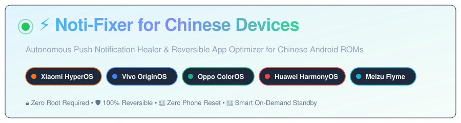
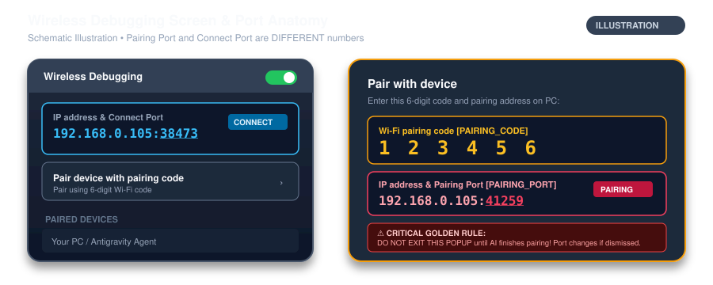
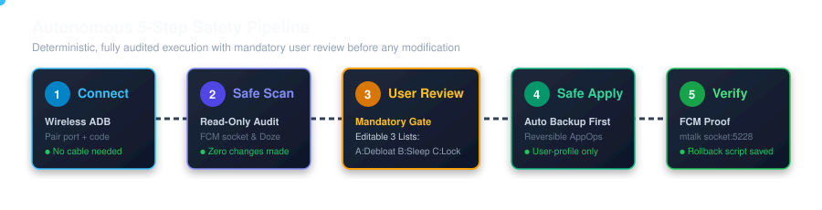
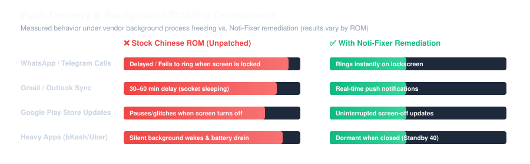

<div align="center">



### Autonomous Push Notification Healer & Reversible Battery Optimizer for Chinese Android ROMs
*Engineered for Xiaomi HyperOS / MIUI • Vivo OriginOS • Oppo ColorOS • Huawei HarmonyOS • Meizu Flyme*

[](https://github.com/shovo127/Noti-Fixer-for-Chinese-Devices/actions)
[](LICENSE)
[](https://python.org)
[](https://developer.android.com)
[-brightgreen.svg)](#-truthful-safety-guarantees)
[](https://github.com/shovo127)

<p align="center">
  <b>Tired of missed WhatsApp/Telegram calls, delayed Gmail notifications, and frozen background apps on Chinese ROMs?</b><br>
  Noti-Fixer scientifically prevents background socket freezes, heals Google FCM push sockets, and curtails idle drain without root, without bootloader unlocking, and with 100% reversibility.
</p>

[🚀 Start Here in 3 Steps](#-start-here-in-3-steps) • [⚡ 1-Click AI Prompt](#-the-copy-paste-ai-copilot-command) • [📱 Phone Pairing Anatomy](#-phone-pairing-anatomy-pairing-port-vs-connect-port) • [🎮 Human Launcher](#-for-human-users-1-click-interactive-launcher) • [🛡️ Safety Guarantees](#-truthful-safety-guarantees) • [🌐 Other Projects](#-other-ecosystem-projects-by-the-author) • [🔧 Troubleshooting](#-troubleshooting-guide) • [FAQ](#-frequently-asked-questions-faq)

</div>

---

## 🚀 Start Here in 3 Steps

Follow these three zero-jargon steps to optimize your phone in under 2 minutes:

### Step 1: Prepare Your Phone
1. Connect your phone and computer to the **same Wi-Fi network** (keep battery >30%).
2. Open **Settings** ➔ **About Phone** ➔ Tap **Build Number** (or OS Version) 7 times until you see *"You are now a developer!"*.
3. Go to **Settings** ➔ **Additional Settings / System** ➔ **Developer Options**:
   - Turn **ON** **Wireless Debugging**.
   - *(Xiaomi / Redmi / POCO users: also turn ON "USB debugging (Security settings)")*.
4. Tap the words **"Wireless Debugging"** ➔ tap **"Pair device with pairing code"**.

### Step 2: Open Workspace with an AI Agent
Open this cloned repository folder as your workspace in **Google Antigravity IDE**, **Cursor**, **Claude Code**, or **VS Code** (with GitHub Copilot, Cline, or Roo Code). Ensure your AI assistant has a valid API key or subscription (standard free tiers or paid models both work smoothly; free tiers may encounter typical hourly query rate limits during extensive package scans).

### Step 3: Copy and Paste the Command
Copy the ready-made prompt below, fill in the 4 bracketed placeholders from your phone screen, and paste it into your AI chat!

---

## ⚡ The Copy-Paste AI Copilot Command

Copy the block below, replace `[PHONE_IP]`, `[PAIRING_PORT]`, `[PAIRING_CODE]`, and `[CONNECT_PORT]` with the numbers shown on your phone, and paste it into your AI assistant:

```markdown
Hey AI Agent! Please optimize my phone using the Noti-Fixer repository:

TARGET PHONE CONNECTION:
- Phone IP:       [PHONE_IP]       (Example: 192.168.0.105)
- Pairing Port:   [PAIRING_PORT]   (Example: 41259 - from the "Pair with code" popup)
- Pairing Code:   [PAIRING_CODE]   (Example: 123456 - 6-digit code on the popup)
- Connect Port:   [CONNECT_PORT]   (Example: 38473 - from the main Wireless Debugging page)

AI AGENT DIRECTIVES (Read AGENTS.md and .gemini/skills/noti-fixer/SKILL.md first):
1. SAFETY FIRST: Never reset the phone (zero factory reset, zero wipe, zero recovery reboot). Zero root, zero bootloader unlock. All commands must pass scripts/safety_guard.py.
2. CONNECT: Run adb pair <PHONE_IP>:<PAIRING_PORT> <PAIRING_CODE>, then adb connect <PHONE_IP>:<CONNECT_PORT>. Remind me to keep my screen ON and stay on the pairing popup until paired.
3. SAFE SCAN (READ-ONLY): Run scripts/detect_device.py and scripts/audit_fcm_doze.py. Show me the findings and ASK ME TO CONFIRM before changing anything.
4. PROPOSE 3 EDITABLE LISTS:
   - List A (Debloat Candidates): Non-critical vendor bloat to remove via safe user-profile uninstalls (pm uninstall -k --user 0).
   - List B (Background Restrict Candidates): High-drain apps to put into On-Demand Standby (Bucket 40 / RARE). They run at 100% full speed when I open them.
   - List C (Protected Frameworks): Google Play Store, Play Services, Download Manager, Zoom, Phone, SMS, Keyboards, and Banking apps. NEVER touched.
   Ask me to add/remove apps from A or B. Apply nothing until I confirm.
5. BACKUP & APPLY: Create a backup snapshot in backups/<timestamp>/, apply the approved list, deploy scripts/millet_watchdog.sh, and pulse FCM keepalive.
6. VERIFY: Re-audit the FCM socket (mtalk.google.com:5228), show a before/after summary, and provide the exact 1-click rollback command.
```

---

## 📱 Phone Pairing Anatomy (Pairing Port vs. Connect Port)

> [!IMPORTANT]
> **Android assigns TWO DIFFERENT PORTS for security.**  
> - **Pairing Port:** Appears *inside* the 6-digit code popup dialog. Used only once to establish trust (`adb pair`).
> - **Connect Port:** Appears on the *main* Wireless Debugging screen under your IP. Used for ongoing communication (`adb connect`).

<div align="center">

</div>

### ⚠️ While the AI Connects: DO and DON'T

| ✅ DO | ❌ DON'T |
| :--- | :--- |
| **DO** keep the pairing code popup dialog open on your screen until the AI confirms pairing. | **DO NOT** leave, back out of, or minimize the Wireless Debugging popup while pairing. |
| **DO** keep your phone screen awake and unlocked. | **DO NOT** toggle Wireless Debugging OFF and ON while the AI is connecting. |
| **DO** ensure phone and PC remain connected to the exact same Wi-Fi network. | **DO NOT** switch Wi-Fi networks or activate VPNs on your phone during connection. |
| **DO** tap "Always allow from this computer" if an authorization prompt appears. | **DO NOT** panic if ports change after reboot — use `scripts/scan_ports.py` to auto-reconnect. |

---

## 🤖 What the AI Will Do (Autonomous 5-Step Pipeline)

When you send the command, your AI executes the deterministic 5-step safety workflow:

<div align="center">

</div>

1. **Safe Read-Only Scan:** Audits brand, ROM, Android version, kernel freezer state, and live FCM push socket (`mtalk.google.com:5228`).
2. **Diagnostic Summary:** Presents a clear summary of vendor bottlenecks and asks: *"Do you confirm this diagnosis? (yes/edit)"*.
3. **Presents 3 Editable Lists:**
   - **List A (Debloat):** Vendor analytics and ads safe to remove for user profile only (`pm uninstall -k --user 0`).
   - **List B (Background-Sleep):** Secondary apps (e.g., e-commerce, ride-sharing) put into On-Demand Standby (Bucket 40). They work normally when opened.
   - **List C (Protected Frameworks):** Critical system services, Play Store, Zoom, and banking apps that are hard-locked and never modified.
4. **Automated Backup Snapshot:** Saves existing states to `backups/<timestamp>/` and generates a 1-click `restore.bat` / `restore.sh`.
5. **Precision Remediation & Verification:** Applies approved configurations, deploys watchdog persistence, verifies the Google FCM socket, and outputs verification logs.

---

## 📊 Before & After Empirical Comparison

Results vary across individual devices, ROM updates, and carrier builds:

<div align="center">

</div>

---

## 🎮 For Human Users: 1-Click Interactive Launcher

Prefer running without an AI? Launch the interactive terminal suite:

### 🪟 Windows:
Double-click `scripts/NotiFixer_OneClick.bat` in File Explorer.

### 🐧 macOS / Linux:
```bash
chmod +x scripts/NotiFixer_OneClick.sh
./scripts/NotiFixer_OneClick.sh
```

| Option | Feature | Purpose |
| :---: | :--- | :--- |
| `[1]` | ⚡ **Simple Wireless Connect & Fix** | Pairs via Wi-Fi and applies brand-specific push fixes. |
| `[2]` | 🔌 **USB Cable 1-Click Fix** | Plug in USB cable with USB debugging enabled to fix instantly. |
| `[3]` | 🔍 **Live Diagnostic Audit** | Tests Google FCM socket (`5228`), Android Doze, and freezer. |
| `[4]` | 📱 **Device Profile Fingerprint** | Identifies hardware, ROM generation, and kernel parameters. |
| `[5]` | 🔋 **Battery Drain Inspector** | Inspects background drainers and active CPU wakelocks. |
| `[6]` | 🛡️ **Start MILLET Watchdog** | Background daemon that prevents HyperOS from resetting whitelists. |
| `[7]` | 🔄 **Wireless Port Scanner** | Auto-discovers new dynamic ports across `30000–49999` after reboot. |
| `[8]` | 🛠️ **Unfreeze Background Apps** | Restores background network and execution for Play Store & apps. |
| `[9]` | 🧹 **Safe Bloatware & Ad Debloater** | Removes recommended vendor ads & bloat for User 0 (100% reversible). |
| `[10]`| 🛡️ **Zero-Latency Ad-Blocker Manager** | Local on-device 0ms loopback & low-latency DNS optimizer. |
| `[11]`| ⏪ **Master 100% Safe Rollback** | Reinstalls debloated packages and reverts all settings to stock. |
| `[12]`| ❌ **Exit** | Closes the repair suite. |

---

## 🛡️ Truthful Safety Guarantees

Your smartphone contains your personal life, banking credentials, and private conversations. Noti-Fixer operates strictly within sanctioned user-space Android boundaries:

> [!CAUTION]
> ### 🚫 TOTAL PROHIBITION: ZERO PHONE RESET & ZERO DATA LOSS GUARANTEE
> **Resetting the phone or wiping data is TOTALLY PROHIBITED across the entire repository.**  
> Fixing notifications and battery drain is a simple user-space ADB configuration task. Resetting the phone, wiping user data, unlocking bootloader, or rooting is completely unnecessary, unacceptable, and forbidden.  
> 
> The integrated safety interceptor ([`scripts/safety_guard.py`](scripts/safety_guard.py)) programmatically halts and aborts any command containing: `factory_reset`, `master_clear`, `wipe`, `format`, `erase`, `locksettings clear`, `reboot recovery`, `reboot bootloader`, `fastboot`, `oem unlock`, `pm clear`, or `pm disable`.

- **100% Root-Free:** Does NOT require Magisk, KernelSU, or SuperSU. Never escalates privileges.
- **Zero Bootloader Unlock Needed:** Bootloader remains locked. DRM Widevine L1 (Netflix HD/4K) and device security remain untampered.
- **Reversible User-Profile Debloat Only:** When debloating vendor apps from List A, commands execute strictly via `pm uninstall -k --user 0 <pkg>`. This removes the app **only for your user profile** while leaving the `/system` partition untouched.
- **100% Reversible Package Reinstallation:** Any uninstalled package can be restored instantly via `cmd package install-existing --user 0 <pkg>` (or via `python scripts/restore_backup.py`).
- **Core System Protection Lock:** Google Play Store (`com.android.vending`), Play Services (`com.google.android.gms`), Download Manager (`com.android.providers.downloads`), Zoom (`us.zoom.videomeetings`), SystemUI, Phone, Settings, Keyboards, and Launchers are permanently locked and cannot be disabled.
- **100% Offline & Private:** Operates entirely over local ADB. Zero telemetry, zero analytics, zero external network requests.

---

## 🚀 Supported Device Ecosystems

| Brand | System Versions | Proprietary Vendor Mechanics Handled |
| :--- | :--- | :--- |
| **Xiaomi / POCO / Redmi** | HyperOS 1.0, 2.0, 3.0 • MIUI 12–14 | MILLET framework, PowerKeeper tables, MIUI AppOps `10008` & `10021` |
| **Vivo / iQOO** | OriginOS 3, 4, 5 • FuntouchOS 13–15 | PEM, Jovi Engine, High Background Power Consumption whitelists |
| **Oppo / OnePlus / Realme** | ColorOS 12–15 • OxygenOS • RealmeUI | Athena daemon, GuardElf, Quick Freeze bypass, Auto-revoke disable |
| **Huawei / Honor** | HarmonyOS 2–4, NEXT • MagicOS 7–8 | PowerGenie background killer bypass, `hw_power_mode` normal |
| **Meizu** | Flyme 9, 10, Auto | Standby freeze bypass, AppOps autostart |
| **Generic Android** | Stock Android 12–16 / Transsion | Standard Android Doze Whitelist, Standby Buckets, Netpolicy |

---

## 🔄 Emergency Rollback (1-Click Revert)

To return your phone to 100% factory default configuration or reinstall debloated apps:
```bash
python scripts/restore_backup.py
```
*(Or select **Option `[9]`** in `NotiFixer_OneClick.bat` / `.sh`)*.  
The restorer reinstalls debloated packages for User 0, restores kernel freezer settings, and resets AppOps to system defaults.

---

## 🔧 Troubleshooting Guide

| Issue | Root Cause | Solution |
| :--- | :--- | :--- |
| **Port changed after phone reboot** | Android assigns random ports to Wireless Debugging on reboot. | Run `python scripts/scan_ports.py -ip <PHONE_IP>` (Option `[7]`) to auto-discover the new port in seconds. |
| **`device unauthorized` error** | Phone has not approved your PC's ADB cryptographic key. | In Developer Options, tap **"Revoke USB debugging authorizations"**, toggle Wireless Debugging OFF and ON, and approve the popup. |
| **Xiaomi toggle missing / grayed out** | HyperOS requires a SIM card to enable *"USB debugging (Security settings)"*. | Insert any active SIM card once, toggle the switch ON, and complete Xiaomi's 3-step prompt. SIM can then be removed. |
| **Cannot connect over Wi-Fi** | Router has **AP / Client Isolation** enabled. | Disable Client Isolation in router settings, connect both to a phone hotspot, or simply use a standard USB cable (Option `[2]`). |
| **Battery drain at night with Wi-Fi off** | Rogue messaging apps in Doze Whitelist spam offline MQTT keepalives. | Noti-Fixer removes messaging apps from Doze Whitelist while keeping GMS FCM push active. |
| **Play Store updates pause on lock** | Kernel freezer freezes download manager on screen-off. | Run `python scripts/restore_background_health.py` (Option `[8]`) to restore unthrottled download engine permissions. |

---

## ❓ Frequently Asked Questions (FAQ)

<details>
<summary><b>Will my morning alarm clock (DeskClock) still wake me up in deep sleep?</b></summary>
<b>Yes, 100% guaranteed.</b> Noti-Fixer enforces triple-layer protection for system alarm clocks (Android Doze Whitelist, Standby Bucket 5 EXEMPTED, and Xiaomi PowerKeeper <code>power_alarm_white_list</code>). Your morning alarm will fire with second-level precision even during the deepest Doze sleep.
</details>

<details>
<summary><b>Why shouldn't messaging apps be in the Android Doze Whitelist?</b></summary>
When a messaging app (e.g. Messenger or imo) is in the Doze Whitelist, Android disables Doze sleep for it. When you turn off Wi-Fi before bed, the app's internal MQTT keepalive alarms wake up the CPU 100+ times trying to reconnect. By keeping only Google Play Services (GMS) in the Doze Whitelist, GMS handles instant push when online, while offline sleep is 100% undisturbed.
</details>

<details>
<summary><b>Can this harm my phone or delete my photos?</b></summary>
<b>No.</b> Noti-Fixer operates exclusively in user-space settings via standard Android ADB APIs. It contains programmatic interceptors that block any factory reset, wipe, format, or system partition modification.
</details>

<details>
<summary><b>Does debloating remove apps permanently?</b></summary>
<b>No.</b> Debloating uses Android's safe user-profile uninstallation (<code>pm uninstall -k --user 0</code>). The system APK remains safe in the factory read-only partition and can be reinstalled in 1 second using <code>python scripts/restore_backup.py</code>.
</details>

<details>
<summary><b>Does this drain more battery?</b></summary>
<b>No.</b> While messaging apps are kept alive to receive push notifications, secondary battery drainers (e-commerce, ride-sharing, food delivery) are placed in On-Demand Standby (Bucket 40) where they consume 0% power when closed.
</details>

<details>
<summary><b>What happens when my phone restarts?</b></summary>
Core system configurations persist across reboots. On Xiaomi HyperOS devices, the lightweight <code>millet_watchdog.sh</code> script monitors and prevents vendor daemons from wiping whitelists.
</details>

---

## 🌐 Other Ecosystem Projects by the Author

If you find Noti-Fixer useful, explore other open-access web platforms and tools engineered by **Mohammed Thuhidul Islam Shovo**:

| Project | Live Web Platform | Overview |
| :--- | :--- | :--- |
| ✉️ **Mail Merge By Shovo** | [**mailmergebyshovo.qzz.io**](https://mailmergebyshovo.qzz.io) | Free, full-featured browser-based Gmail Mail Merge suite with native compose workflow, CSV campaigns, personalized tokens, and productivity utilities — no subscriptions or hidden limits. |
| 🇩🇪 **Lerne Deutsch Mit Technologie** | [**lernedeutschmittechnologie.tech**](https://lernedeutschmittechnologie.tech) | Next-generation German language learning hub featuring free interactive lessons, Goethe exam preparation labs, speech technology, and advanced grammar practice tools. |

---

## 🤝 Contributing

Contributions from Android developers, ROM testers, and reverse-engineers are warmly welcomed! Please read [`CONTRIBUTING.md`](CONTRIBUTING.md) and [`docs/PRD.md`](docs/PRD.md) before submitting pull requests.

---

## 📜 Credit, License & Legal Terms

- **Architect & Maintainer:** **[Mohammed Thuhidul Islam Shovo (shovo127)](https://github.com/shovo127)**
- **Notice & Attribution:** See [`NOTICE`](NOTICE) for mandatory attribution requirements.
- **License:** Licensed under the **[Noti-Fixer Personal Non-Commercial License](LICENSE)** (Copyright (c) 2026 Mohammed Thuhidul Islam Shovo).
  - **Allowed:** 100% free for individual users to download, inspect, and use on devices they own.
  - **Prohibited:** Commercial exploitation, paid repair shop usage, rebranding, unauthorized distribution, and closed-source monetization are strictly forbidden without prior written authorization.
