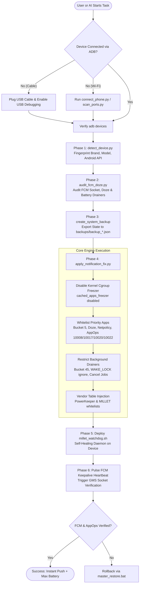

# #02 — AppFlow.md: Application & AI Interaction Flow

**Project Name:** Noti-Fixer for Chinese Devices  
**Repository:** `https://github.com/shovo127/Noti-Fixer-for-Chinese-Devices`  
**Architect:** Mohammed Thuhidul Islam Shovo (shovo127)  
**Document Version:** 2.0.0 (Blueprint Lock Standard)  

---

## 1. End-to-End System Workflow

---

## 2. Interactive User Flow (CLI Experience)

### Stage 1: Launcher Menu
1. The user launches `NotiFixer_OneClick.bat` (Windows) or `NotiFixer_OneClick.sh` (Linux/macOS).
2. The user selects from 8 standardized options:
   * `[1]` Simple Wireless Wi-Fi Connect & Fix (Interactive pairing wizard).
   * `[2]` USB Cable 1-Click Notification & Battery Fix.
   * `[3]` Live Diagnostic Audit (FCM Socket, Android Doze, Kernel Freezer).
   * `[4]` Device Fingerprint & Hardware/ROM Profile.
   * `[5]` Battery Drain Analysis & Culprit Inspector.
   * `[6]` Push & Start Persistent Watchdog Daemon.
   * `[7]` Wireless ADB Port Scanner (Post-reboot discovery).
   * `[8]` 100% Reversible Rollback.

### Stage 2: Automated Execution Flow
1. **Safety Interceptor Check:** Every command passes through `safety_guard.py`. Any destructive command triggers immediate abort.
2. **Pre-flight Snapshot:** Capture current system settings into `backups/backup_<device>_<timestamp>.json`.
3. **Execution with Visual Progress:** Display clear step counters `[1/7]` through `[7/7]` with colored ANSI feedback.
4. **Post-execution Verification:** Display tabular verification showing Standby Bucket, Heads-up status, and Doze whitelist status.

---

## 3. AI Agent Autonomous Protocol (Skill Flow)

When an AI Agent (Antigravity, Claude Code, Cursor) is asked:
> *"Fix my Chinese phone's notifications and battery using Noti-Fixer"*

The AI Agent must follow this deterministic 5-step protocol:

1. **Phase 1: Discover & Connect**
   - Probe existing ADB endpoints: `adb devices`.
   - If offline or disconnected over Wi-Fi, run `python scripts/scan_ports.py -ip <IP>`.
2. **Phase 2: Audit Without Modification**
   - Execute `python scripts/detect_device.py` to identify vendor ROM (`HyperOS`, `OriginOS`, `ColorOS`, `HarmonyOS`).
   - Execute `python scripts/audit_fcm_doze.py` to identify frozen sockets and missing whitelists.
   - Execute `python scripts/inspect_battery.py` to identify live battery culprits.
3. **Phase 3: Present Plan to User**
   - Inform the user which apps are blocked (e.g. missing heads-up banners, frozen sockets) and which apps are consuming battery in the background.
4. **Phase 4: Execute Safe Remediation**
   - Execute `python scripts/apply_notification_fix.py -s <serial>`.
   - Deploy and start watchdog daemon: `/data/local/tmp/millet_watchdog.sh`.
5. **Phase 5: Output Empirical Proof**
   - Deliver a concise Markdown verification table confirming:
     * FCM Socket: `CONNECTED`
     * Standby Bucket: `5` (Exempted) for priority messaging apps.
     * Standby Bucket: `45` (Restricted) for background heavy apps.
     * Watchdog PID: Active.

